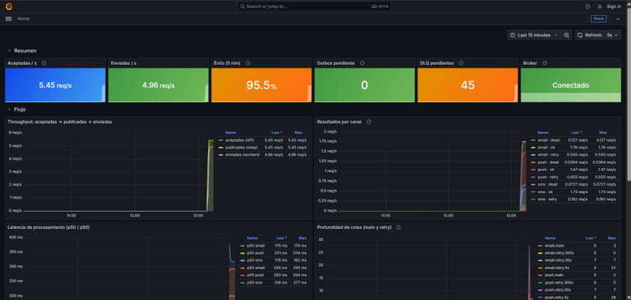
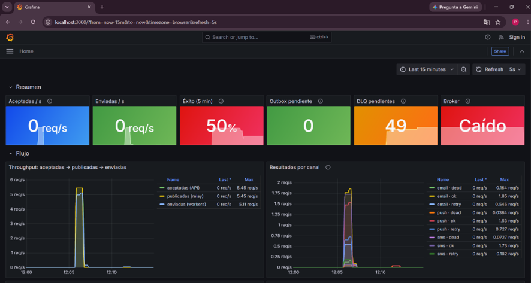
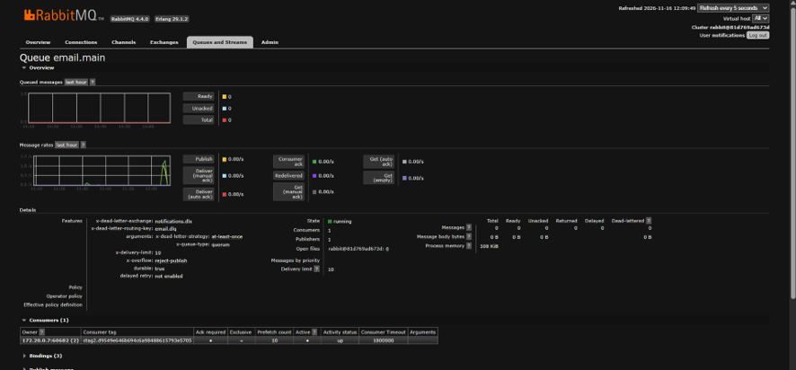
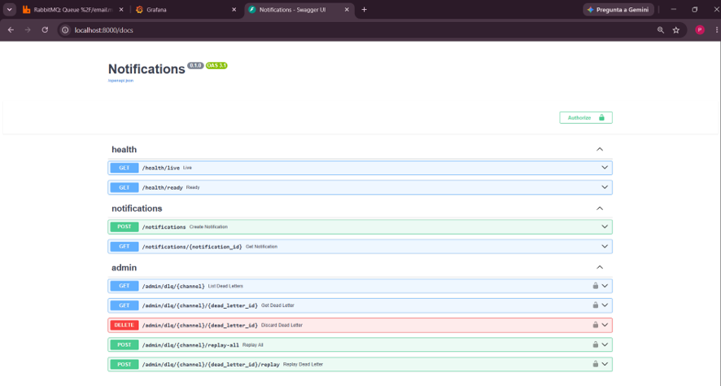
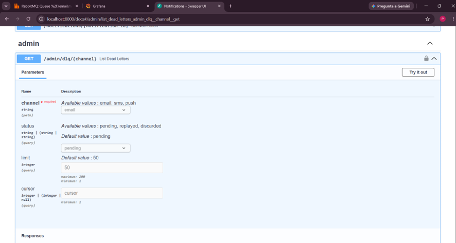
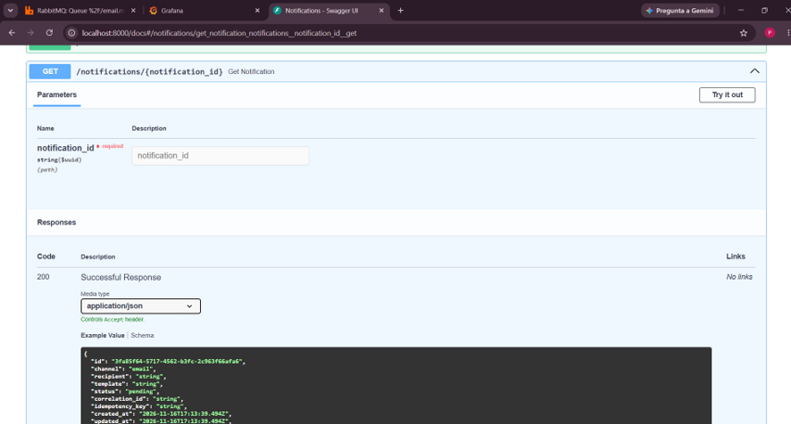
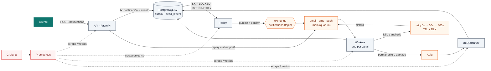
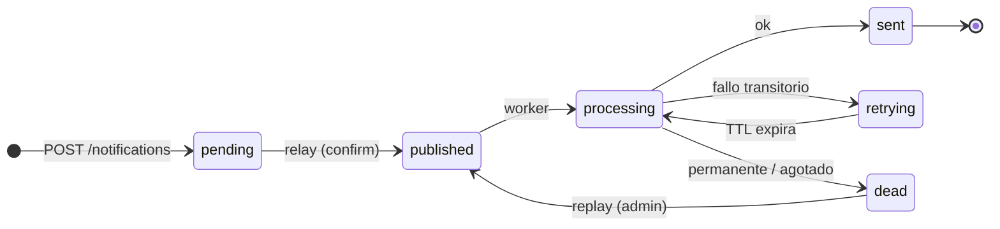

<div align="center" style="padding: 2% 0;">

# Sistema de notificaciones

<p>
  
  
  
  
</p>

<p>
  
  
  
  
  
  
  
  
</p>

Sistema de notificaciones **asíncrono y basado en eventos** (email, SMS y push): productores y consumidores desacoplados, outbox transaccional, **reintentos con backoff**, **dead-letter queues** con reprocesamiento y observabilidad completa.

Es un **proyecto de portafolio**. Los proveedores de envío están **simulados**: el foco es la fiabilidad de entrega, no la integración con SMTP, Twilio o FCM.

</div>

---

## Capturas

### Observabilidad

  <div align="center">
    
    
  </div>

### Mensajería y API

  <div align="center">
    
    
    
    
  </div>

## Descripción

Una API **FastAPI** recibe notificaciones y las guarda junto a su evento en una **tabla outbox**, en la misma transacción. Un **relay** publica esos eventos en **RabbitMQ** con *publisher confirms*, y un **worker por canal** los entrega con idempotencia. Los fallos transitorios recorren colas de **retry** (5 s → 30 s → 5 min) y los permanentes o agotados terminan en una **DLQ** que se archiva en Postgres y se puede reprocesar desde una API admin.

- **Sin pérdida de eventos**: si el broker o el relay caen, los eventos esperan en la outbox y se publican al volver.
- **Effectively-once**: entrega *at-least-once* más idempotencia del consumidor; un duplicado nunca se reenvía.
- **Observable**: métricas Prometheus en cada proceso, dashboard Grafana provisionado y logs JSON con `correlation_id`.

La documentación técnica está en [`docs/arquitectura.md`](docs/arquitectura.md) y las 45 decisiones de diseño en [`docs/decisiones.md`](docs/decisiones.md).

## Características

| Característica               | Descripción                                                                                                              |
| ---------------------------- | ------------------------------------------------------------------------------------------------------------------------ |
| **Outbox transaccional**     | La notificación y su evento se guardan en una transacción; `pg_notify` despierta al relay al instante.                   |
| **Relay escalable**          | `SELECT … FOR UPDATE SKIP LOCKED`: N réplicas sin publicar dos veces el mismo evento. Backoff por fila si el broker cae. |
| **Publisher confirms**       | Un evento sólo se marca publicado cuando el broker lo confirma; `mandatory` detecta mensajes no enrutables.              |
| **Reintentos escalonados**   | Colas `retry.{5s,30s,300s}` con TTL + dead-letter exchange; cabecera `x-attempt` en cada vuelta.                         |
| **Clasificación de errores** | `PermanentError` (destinatario inválido, payload roto) va directo a la DLQ; el resto se reintenta.                       |
| **Idempotencia**             | Productor: `idempotency_key` (409 si el cuerpo cambia). Consumidor: `processed_messages` dentro de la tx del envío.     |
| **DLQ persistente**          | Cada mensaje muerto se archiva con motivo, traceback, intentos y mensaje original.                                       |
| **API admin**                | Listar (paginado por cursor), detalle, replay individual o masivo con `x-attempt` reiniciado y descarte. API key.       |
| **Historial**                | `GET /notifications/{id}` devuelve el estado y cada intento: resultado, error y tiempos.                                 |
| **Métricas y dashboard**     | Embudo aceptadas → publicadas → enviadas, resultados por canal, latencia p50/p95, profundidad de colas y DLQ.            |
| **Resiliencia**              | Reconexión automática a RabbitMQ; un reinicio del broker no tumba procesos ni duplica envíos en vuelo.                   |
| **Graceful shutdown**        | SIGTERM: dejar de consumir, drenar mensajes en vuelo con timeout y cerrar canales, conexión y pool.                      |

## Arquitectura



| Proceso        | Entrypoint                           | Rol                                                                       |
| -------------- | ------------------------------------ | ------------------------------------------------------------------------- |
| `api`          | `notifications-api`                  | Recibe notificaciones (outbox), estado e historial, API admin de DLQ.     |
| `relay`        | `notifications-relay`                | Publica la outbox en RabbitMQ con confirms. Escalable horizontalmente.    |
| `worker-*`     | `notifications-worker --channel <c>` | Entrega por canal con idempotencia, historial y clasificación de errores. |
| `dlq-archiver` | `notifications-dlq`                  | Archiva las DLQ en Postgres y calcula los gauges de colas, DLQ y outbox.  |

Una sola imagen Docker para todos los procesos: el comando decide el rol.

### Ciclo de vida de una notificación



## Estructura del proyecto

```text
sistema-notificaciones/
├── 📁 src/notifications/
│   ├── 📁 api/                  # FastAPI: routers públicos y admin, API key, correlación
│   ├── 📁 relay/                # outbox → RabbitMQ (SKIP LOCKED, backoff, LISTEN/NOTIFY)
│   ├── 📁 worker/               # handler por canal, idempotencia, proveedores simulados
│   ├── 📁 dlq/                  # archivador de DLQ, replay y descarte
│   ├── 📁 messaging/            # Protocol MessageBus, adaptador RabbitMQ, topología, política de retry
│   ├── 📁 contracts/            # envelope y eventos versionados (Pydantic)
│   ├── 📁 db/                   # modelos SQLAlchemy y repositorios
│   ├── 📄 monitor.py            # gauges: profundidad de colas, DLQ y outbox
│   ├── 📄 observability.py      # structlog JSON, correlation_id y métricas
│   ├── 📄 errors.py             # TransientError / PermanentError
│   └── 📄 config.py             # pydantic-settings, validación al arrancar
├── 📁 migrations/               # Alembic (async)
├── 📁 tests/
│   ├── 📁 unit/                 # backoff, política, topología, parsing, API sin DB
│   └── 📁 integration/          # Testcontainers: RabbitMQ y Postgres reales
├── 📁 infra/                    # Prometheus y Grafana (datasource + dashboard provisionados)
├── 📁 scripts/                  # demo de mensajería y generador de carga
├── 📁 docs/                     # arquitectura y registro de decisiones
├── 📄 docker-compose.yml        # 11 servicios
├── 📄 Dockerfile                # multi-stage con uv, usuario no root
├── 📄 justfile                  # tareas: up, test, lint, load, stats…
└── 📄 pyproject.toml
```

## Stack tecnológico

| Categoría       | Tecnología                                                             |
| --------------- | ---------------------------------------------------------------------- |
| Runtime         | Python 3.13, `asyncio` de punta a punta                                |
| API             | FastAPI, Pydantic v2, `pydantic-settings`, uvicorn                     |
| Mensajería      | RabbitMQ 4 (quorum queues, DLX, TTL), `aio-pika` con conexión robusta  |
| Base de datos   | PostgreSQL 17, SQLAlchemy 2.1 async + `asyncpg`, Alembic               |
| Observabilidad  | `structlog` (JSON + `correlation_id`), `prometheus-client`, Grafana 11 |
| Pruebas         | pytest, pytest-asyncio, Testcontainers (RabbitMQ y Postgres reales)    |
| Calidad         | ruff (lint + format), mypy `--strict`, pre-commit, GitHub Actions      |
| Infraestructura | Docker Compose, uv, just                                               |

## Requisitos

- **Docker Desktop** (Windows o Mac) o Docker Engine (Linux).
- **[uv](https://docs.astral.sh/uv/)** para dependencias y entorno.
- **[just](https://just.systems/)** para las tareas: `uv tool install rust-just`.

No necesitas instalar Python, PostgreSQL ni RabbitMQ: uv descarga Python 3.13 y el resto corre en Docker.

## Comandos

| Comando                          | Descripción                                                             |
| -------------------------------- | ----------------------------------------------------------------------- |
| `just up`                        | Construye y levanta los 11 servicios esperando los healthchecks.        |
| `just down` · `just nuke`        | Para los servicios (`nuke` borra también los volúmenes).                |
| `just sync`                      | Instala las dependencias según `uv.lock`.                               |
| `just test`                      | Todos los tests (requiere Docker). `just test-unit` sólo los unitarios. |
| `just lint`                      | `ruff check`, `ruff format --check` y `mypy --strict`.                  |
| `just fmt`                       | Arregla lint y formato.                                                 |
| `just load --count 200`          | Genera carga: canales aleatorios, destinatarios inválidos y duplicados. |
| `just stats`                     | Estados por canal e intentos por resultado.                             |
| `just demo-bus --mode transient` | Demo de la mensajería aislada: retry escalonado hasta la DLQ.           |
| `just psql "<sql>"`              | Consulta rápida contra el Postgres del compose.                         |
| `just logs <servicio>`           | Logs en vivo (JSON).                                                    |

## Configuración y uso

### 1. Levantar el sistema

```bash
cp .env.example .env          # en Windows: copy .env.example .env
just up                       # la primera vez tarda unos minutos
just load --count 200         # genera tráfico
```

| Servicio            | URL                                                                            |
| ------------------- | ------------------------------------------------------------------------------ |
| API (Swagger)       | <http://localhost:8000/docs>                                                   |
| Grafana             | <http://localhost:3000> (dashboard *Notificaciones*; admin: `admin` / `admin`) |
| Prometheus          | <http://localhost:9090>                                                        |
| RabbitMQ management | <http://localhost:15672> (`notifications` / `notifications`)                   |
| PostgreSQL          | `localhost:5433` (`notifications` / `notifications`)                           |

### 2. Enviar y consultar una notificación

```bash
curl -i -X POST localhost:8000/notifications -H "Content-Type: application/json" \
  -d '{"channel":"email","recipient":"ada@example.com","template":"welcome","payload":{"name":"Ada"},"idempotency_key":"k1"}'

curl localhost:8000/notifications/<notification_id>     # estado + historial de intentos
```

Si repites el POST con la misma `idempotency_key`, devuelve la misma notificación (`Idempotent-Replayed: true`). Si la reutilizas con otro cuerpo, devuelve `409`.

### 3. Gestionar la DLQ

Los endpoints admin exigen la cabecera `X-API-Key` (en Swagger: botón *Authorize*).

```bash
K="X-API-Key: change-me-please-0123456789"
curl -H "$K" "localhost:8000/admin/dlq/email?limit=10"             # paginado: sigue con ?cursor=<next_cursor>
curl -H "$K" localhost:8000/admin/dlq/email/<id>                    # traceback, cabeceras y envelope
curl -X POST -H "$K" localhost:8000/admin/dlq/email/<id>/replay     # vuelve a email.main con x-attempt=0
curl -X POST -H "$K" "localhost:8000/admin/dlq/sms/replay-all?reason=exhausted"
curl -X DELETE -H "$K" localhost:8000/admin/dlq/email/<id>          # descarte lógico
```

### 4. Probar la resiliencia

```bash
docker compose kill rabbitmq       # la API sigue aceptando; la outbox crece
just load --count 50
docker compose start rabbitmq      # el relay publica lo pendiente y los workers reconectan solos
docker compose restart rabbitmq    # con carga: ningún proceso se reinicia y no hay envíos duplicados
```

En Grafana, el panel **Broker** pasa a *Caído* y vuelve a *Conectado*; **Outbox pendiente** sube y se vacía.

### Variables principales de `.env`

| Variable                                                  | Qué hace                                                                                      |
| --------------------------------------------------------- | --------------------------------------------------------------------------------------------- |
| `DB_URL`                                                  | Postgres con driver `postgresql+asyncpg` (validado al arrancar).                              |
| `RABBITMQ_URL`, `RABBITMQ_MANAGEMENT_URL`                 | Broker y API de management (para `queue_depth`).                                              |
| `RABBITMQ_PREFETCH`                                       | Mensajes en vuelo por worker.                                                                 |
| `RETRY_DELAYS_SECONDS`                                    | Niveles de retry, p. ej. `[5,30,300]`. Su longitud es el máximo de reintentos.               |
| `RELAY_BATCH_SIZE`, `RELAY_POLL_INTERVAL_SECONDS`         | Tamaño del lote y polling de respaldo del relay.                                              |
| `WORKER_SIM_*`                                            | Latencia y tasas de fallo del proveedor simulado. En compose, por canal (`EMAIL_*`, `SMS_*`, `PUSH_*`). |
| `WORKER_DRAIN_TIMEOUT_SECONDS`                            | Espera máxima a mensajes en vuelo al apagar.                                                  |
| `API_ADMIN_KEY`                                           | Clave de la API admin (mínimo 16 caracteres).                                                 |
| `METRICS_PORT`, `METRICS_MONITOR_INTERVAL_SECONDS`        | `/metrics` de los procesos sin HTTP y frecuencia de sondeo de gauges.                         |

La lista completa con valores por defecto está en [`.env.example`](.env.example). Una variable inválida o ausente hace que el proceso termine al arrancar con código 2.

## Pruebas

```bash
just test-unit           # 112 unitarias: backoff, política de retry, topología, parsing, API sin DB
just test-integration    # 48 de integración con RabbitMQ y Postgres reales (Testcontainers)
```

Las pruebas de integración cubren los criterios de cada fase:

| Escenario                                                                      | Test                                                          |
| ------------------------------------------------------------------------------ | ------------------------------------------------------------- |
| Mensaje fallido recorre los 3 retries y termina en la DLQ                      | `test_transient_exhausts_three_retries_then_dlq`              |
| Se mata el broker (SIGKILL) a mitad de publicar 400 eventos: ninguno se pierde | `test_broker_crash_during_publish_loses_no_events`            |
| Duplicados (secuenciales y concurrentes) no se reprocesan                      | `test_duplicate_delivery_*`, `test_concurrent_duplicates_*`   |
| Error permanente va directo a la DLQ                                           | `test_permanent_error_goes_straight_to_dlq`                   |
| Replay desde la DLQ con `x-attempt` reiniciado hasta `sent`                    | `test_dead_notification_is_delivered_after_replay`            |
| Reinicio del broker con un mensaje en vuelo: sin caída ni duplicado            | `test_worker_survives_broker_restart_without_reprocessing`    |
| Varias réplicas del relay sin publicar dos veces                               | `test_concurrent_relays_never_publish_same_row_twice`         |

CI en GitHub Actions: `ruff check`, `ruff format --check`, `mypy --strict` y `pytest` completo.

## Documentación

| Documento                                      | Para qué sirve                                                                                     |
| ---------------------------------------------- | -------------------------------------------------------------------------------------------------- |
| [`docs/arquitectura.md`](docs/arquitectura.md) | Flujo, procesos, tablas, envelope, cabeceras y capa de mensajería.                                 |
| [`.env.example`](.env.example)                 | Todas las variables de configuración documentadas.                                                 |

## Información general

- **Nombre del proyecto:** `notifications`
- **Versión:** `0.1.0`
- **Estado:** En desaroollo.
- **Notas:**
  - Los proveedores (email, SMS, push) son **simulados**: latencia aleatoria y tasas de fallo configurables.
  - La garantía es *effectively-once* dentro del sistema. Hacia un proveedor real sigue siendo *at-least-once*; se le pasaría el `message_id` como clave de idempotencia si lo soporta.
  - `POST /notifications` no tiene autenticación (fuera de alcance); los endpoints admin sí.

---

<div align="center">

Proyecto de portafolio · Sistema de notificaciones basado en eventos

</div>
